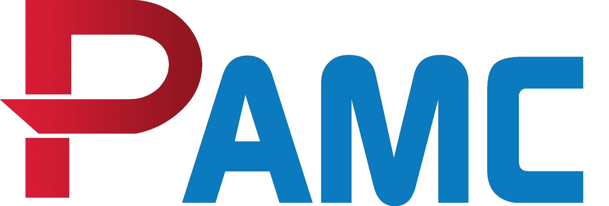
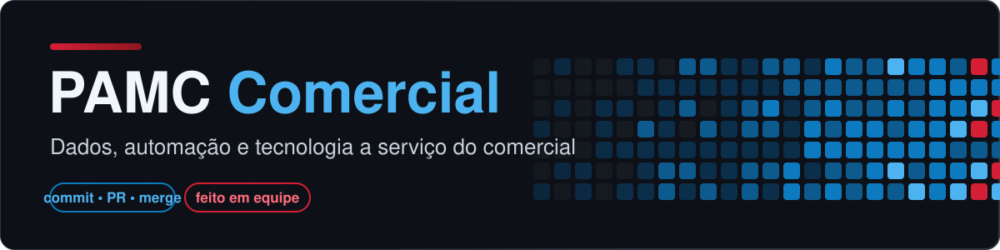

## 👋 Quem somos

Somos a equipe de desenvolvimento da **PAMC**. Construímos as ferramentas que deixam a rotina comercial mais rápida, organizada e confiável: menos trabalho manual, mais informação na mão de quem decide.

## 🧩 No que trabalhamos

| Área | O que fazemos |
| --- | --- |
| 📊 Dados e painéis | Painéis e relatórios de desempenho comercial |
| ⚙️ Automações | Rotinas que substituem tarefas repetitivas do dia a dia |
| 🖥️ Portais internos | Ferramentas para a equipe abrir demandas, acompanhar e decidir |
| 🧠 Inteligência artificial | Apoio de IA no desenvolvimento e na análise |

## 🚀 Em andamento

- **Ata da reunião matinal:** automação que gera a ata do dia e envia por e-mail.
- **Portais e painéis da equipe:** evolução contínua das ferramentas internas.

> Os projetos ficam em repositórios privados da organização.

## 🤝 Como trabalhamos

1. Cada ideia vira uma tarefa no quadro da equipe.
2. Quem desenvolve trabalha em uma branch, nunca direto na principal.
3. Todo código passa por Pull Request e revisão antes do merge.
4. O andamento fica registrado no STATUS de cada projeto.

**PAMC** · equipe de desenvolvimento · feito em equipe, revisado em Pull Request

